# 💪 Daily Challenge - Media Queries

<div align="center">




</div>

The Avengers page from Day 1, extended with four mobile-first breakpoints. The navigation changes color, the title changes size, and the title and description share a row on large screens.

## ▶️ How to run

From the repository root:

```bash
python -m http.server 8000 --bind 127.0.0.1
```

Open [the responsive Avengers page](index.html) through that local server. There are no dependencies or build step. The page reuses the [Day 1 stylesheet](../../../Day1HTMLAndCSS/DailyChallenge/Avengers/style.css), so preserve that relative path when serving or copying the exercise.

## 🎯 The challenge

| Viewport width    | Navigation background / text | Title            | Title and description |
| ----------------- | ---------------------------- | ---------------- | --------------------- |
| Below 600 px      | Navy / white                 | 40 px base style | Title above paragraph |
| 600–767 px        | Yellow / black               | 35 px            | Title above paragraph |
| 768–991 px        | Light green / black          | 25 px            | Title above paragraph |
| 992–1199 px       | Red / white                  | 25 px            | Beside each other     |
| 1200 px and above | Black / white                | 25 px            | Beside each other     |

Each query uses an inclusive `min-width`. Later rules override only the properties they change, so the 25 px title persists at the two larger breakpoints. Navigation links are 20 px bold, with visible keyboard focus.

The page retains the six original hero cards and the Day 1 Thor background made with original CSS gradients and a geometric hammer. No external images, fonts or scripts are required.

## 🧪 Checks

The page was checked in an isolated real browser at **599, 600, 767, 768, 991, 992, 1199 and 1200 px**. Computed colors, title sizes, relative title/paragraph positions and horizontal overflow were inspected. A 375 px screenshot was also reviewed.

Navigation links go to Thor, the team and About. Footer links return to Thor or the team, open the Day 1 page and open the preserved travel demo. Reduced motion retains the content while disabling card motion.

## 🧠 What I learned

- Mobile-first queries add behavior at exact inclusive width boundaries.
- The cascade retains the medium title size while a later query changes the layout.
- One shared base stylesheet keeps the two Avengers pages consistent.
- Checking both sides of a breakpoint catches off-by-one mistakes.

To practise: predict the layout at 767 px and 768 px, inspect both, then explain why the 1200 px title remains 25 px.

## Previous travel exercise

The earlier original travel layout remains runnable at [travel-notes.html](travel-notes.html), with its [unchanged CSS](travel-notes.css) and [preserved explanation](travel-notes.md). It demonstrates different queries and is separate from the Avengers extension above.

---

## 👤 Author

**Kevin Cusnir 'Lirioth'**

Repository: [Fullstack2026](https://github.com/LiriothTeltanion/Fullstack2026)

Week 13 Day 2 - Git and GitHub - Daily Challenge

Updated: 2026-11-25, Asia/Jerusalem. Previous implementation preserved.
