# 💪 Daily Challenge - Media Queries

A small travel blog that rearranges itself as the window grows. A badge in the bottom corner prints the name of the active layout, and its text comes from CSS, so I can watch each media query switch on while I resize.

## ▶️ How to run

Open [travel-notes.html](travel-notes.html) and drag the window edge, or use the device toolbar in DevTools. Switching the system to dark mode changes the colors too.

## 🎯 The challenge

The CSS is mobile first: the base rules are for phones and each query adds to them.

| Media query                    | What changes                                                                                   |
| ------------------------------ | ---------------------------------------------------------------------------------------------- |
| none (base)                    | One column, stacked menu links, badge says "Phone layout"                                      |
| `(min-width: 600px)`           | Menu in one row, posts in two columns, "Tablet layout"                                         |
| `(min-width: 900px)`           | Title and menu share a line, a sticky sidebar joins on the right (`3fr 1fr`), "Desktop layout" |
| `(prefers-color-scheme: dark)` | Every color variable in `:root` gets a dark value                                              |
| `print`                        | Hides the menu and the badge, white background                                                 |

The badge is an empty `p` whose `::after` has `content: "Phone layout"`, and each breakpoint overrides that `content`.

## 🧠 What I learned

- Mobile first means `min-width` queries, and later rules win because they come further down the file
- Changing `content` in `::after` is a quick way to see which breakpoint is active, without any JavaScript
- With colors in custom properties, dark mode is one query that only swaps values
- The badge text was too faint on orange in dark mode, so I added an `--on-accent` color for each theme

---

## 👤 Author

**Kevin Cusnir 'Lirioth'**

Repository: [Fullstack2026](https://github.com/LiriothTeltanion/Fullstack2026)

Week 13 Day 2 - Git and GitHub - Daily Challenge
