# 🧪 Exercise - Login Page

A login card for a made-up site called Study Hub. The browser does the validation with plain HTML attributes, and a small [app.js](app.js) adds a show/hide password button and a friendly message instead of a real submit, because there is no server behind it.

## ▶️ How to run

Open [index.html](index.html). Try an empty form, a bad email or a 5-character password to see the browser stop it.

Use made-up details for this local demo. The fields stay disabled until the
script has installed its event handlers. If JavaScript is disabled or fails
to load, the page explains how to enable the demo. Profile links remain available.
The inputs have no submission names, so their values are excluded from form data.

**Forgot password?** and **Create an account** lead to the local **About this demo**
section. It explains the practice-only form and links back to it. Both fragment
links work with JavaScript disabled; keyboard activation moves focus to the
explanation, and **Back to login demo** returns focus to the form. No account,
password-reset request or email is created by these actions.
The explanation stays hidden until its fragment is selected, preserving the
initial card layout. Returning to the form hides it again using CSS `:target`.

## 🎯 The challenge

| Piece       | How it works                                                                                              |
| ----------- | --------------------------------------------------------------------------------------------------------- |
| Email       | `type="email"`, `required`, `autocomplete="email"`                                                        |
| Password    | `minlength="8"`, `required`, `autocomplete="current-password"`, and a hint linked with `aria-describedby` |
| Show / Hide | A `button type="button"` that flips the input between `password` and `text` and updates `aria-pressed`    |
| Error style | `input:user-invalid` turns the border red, but only after the user has typed                              |
| Submit      | `event.preventDefault()`, then a message in a `role="status"` paragraph, then `form.reset()`              |

The page is one centered card (`display: grid; place-items: center` on the body) over a soft pastel gradient.

## 🌐 Public profile links

The **Find Kevin online** navigation opens my real [GitHub](https://github.com/LiriothTeltanion) and [LinkedIn](https://www.linkedin.com/in/kevin-cusnir-883173b4/) profiles. These destinations are also published on my [GitHub profile](https://github.com/LiriothTeltanion/LiriothTeltanion). They are regular links, separate from the demo form; clicking them does not authenticate with either service or send the form's values.

Both links have visible text, an accessible name that announces the new tab, a keyboard focus outline and a minimum 44-pixel height. The layout wraps on narrow screens. The two Font Awesome Free SVG icons are served locally, so the page does not need a CDN or an icon API. Their source, version and license are recorded in [asset credits](assets/fontawesome/README.md).

To check the interactions, open the page, submit an empty form, try a malformed email and a password shorter than eight characters, then submit valid demo values. Show/Hide should update its pressed state; a valid submission should reset the form and hide the password again. Tab to both profile links and check their focus outlines. You can inspect the links without signing in to either service.

## 🧠 What I learned

- `required`, `type="email"` and `minlength` give real validation before any JavaScript runs
- `:user-invalid` is kinder than `:invalid`, which paints the form red before I've typed anything
- A button inside a form submits by default, so the toggle needs `type="button"`
- Sending a password with a GET form would put it in the URL, which is one more reason the demo stops the submit

---

## 👤 Author

**Kevin Cusnir 'Lirioth'**  
Repository: [Fullstack2026](https://github.com/LiriothTeltanion/Fullstack2026)  
Week 13 Day 2 - Git and GitHub - Exercise
