# 🎮 Mini Project - Shopping Website

A basic HTML/CSS shopping layout with a logo at the left, a Products link at the right and a footer with the current year and author. The product cards use inline-block, so three cards fit on a desktop row. Narrow screens show two or one.

## ▶️ How to run

Run npm run dev from the repository root and open this exercise's index.html. [Products](products.html) is a separate page. Both pages share [style.css](style.css) and the working demo cart in [app.js](app.js).

## 🎯 The challenge

- Basic CSS layout uses floats, block and inline-block.
- Three or more product cards fit in a desktop row.
- The header links to the products page.
- The footer shows the year and Kevin's name.

## Extras

The music catalog, category filter and persisted cart are extras. [Login](login.html) and [registration](signup.html) are responsive bonus forms with native HTML validation. They demonstrate the form layout using test values. Creating accounts and authenticating users require a backend.

---

## 👤 Author

**Kevin Cusnir 'Lirioth'**  
Repository: [Fullstack2026](https://github.com/LiriothTeltanion/Fullstack2026)  
Week 13 Day 2 - Git and GitHub - Mini Project
