# 💪 Daily Challenge - CSS Pattern

A 4 × 4 grid of tiles in navy, coral, gold and sky blue. The HTML is sixteen empty `div`s; every shape comes from CSS. A legend under the pattern explains how each shape is made.

## ▶️ How to run

Open [index.html](index.html) in a browser.

## 🎯 The challenge

1. **The grid.** `.pattern` uses `grid-template-columns: repeat(4, 1fr)` with an 8px gap, and every tile is square thanks to `aspect-ratio: 1`.
2. **One shape per tile.** Each tile draws its shape in `::before`, positioned with `inset`.
3. **Choosing the shape.** `:nth-child(4n + 1)` makes circles, `4n + 2` half circles (two rounded corners on a short box), `4n + 3` quarter circles (one rounded corner) and `4n` diamonds (a rotated square).
4. **Variation.** Rows 2 and 4 get `filter: hue-rotate(160deg)`, picked with `:nth-child(n + 5):nth-child(-n + 8)` and `:nth-child(n + 13)`.

The pattern `div` has `role="img"` and an `aria-label` that describes it, since the tiles themselves say nothing.

## 🧠 What I learned

- `aspect-ratio: 1` keeps the tiles square at any width, so I never had to set a height
- `inset` is a short way to write top, right, bottom and left together
- Two `:nth-child` selectors in a row work as a range, which is how I picked only the second row
- A half circle is a box twice as wide as it is tall with the top corners fully rounded

---

## 👤 Author

**Kevin Cusnir 'Lirioth'**  
Repository: [Fullstack2026](https://github.com/LiriothTeltanion/Fullstack2026)  
Week 13 Day 3 - CSS Grid and Layout - Daily Challenge
