# 🥷 Daily Challenge Ninja - CSS Pattern

The harder version of the pattern challenge: four framed pieces on a gallery-white page, with no images. Two are built with CSS Grid and two are only gradients.

## ▶️ How to run

Open [index.html](index.html). The gallery is an auto-fit grid, so it shows three pieces in a row on a laptop and one on a phone.

## 🎯 The challenge

| Piece | Technique |
|---|---|
| 1. Mondrian | `grid-template-areas` with uneven tracks (`2fr 1fr 1fr`). The 8px black `gap` becomes the painted lines, and the yellow and white blocks span two rows |
| 2. Checkerboard | One `repeating-conic-gradient` tile of 40px, repeated by `background-size`, then tilted with `rotate(-4deg)` |
| 3. Scallop waves | Two `radial-gradient` layers of rings, the second moved by half a tile |
| 4. Diagonals | A 6 × 6 grid of `span`s. `:nth-child(7n + 1)` colors one diagonal coral and `:nth-child(5n + 6)` colors the other blue |

The white Mondrian blocks share one rule, `[class^="m-white"]`, which matches every class that starts with `m-white`.

## 🧠 What I learned

- Named grid areas make a layout readable: the CSS almost looks like the painting
- In a 6-column grid, stepping 7 cells moves one row down and one column right, which is exactly a diagonal
- My first Mondrian needed `!important` because `.mondrian div` was more specific than `.m-red`, so I changed the white selector instead
- A conic gradient with four 25% slices is a whole checkerboard tile in one line

---

## 👤 Author

**Kevin Cusnir 'Lirioth'**  
Repository: [Fullstack2026](https://github.com/LiriothTeltanion/Fullstack2026)  
Week 13 Day 3 - CSS Grid and Layout - Daily Challenge Ninja
