# 🧪 Exercise - My CV

My CV as a web page. The whole sheet is one grid with three named areas (header, side and main), and it also prints as a clean one-page CV. I only listed things that are true today: the bootcamp, the skills from the course and three projects from this repository.

## ▶️ How to run

Open [index.html](index.html). To see the print layout, press Ctrl+P.

## 🎯 The challenge

| Area | Content |
|---|---|
| `header` | Initials badge, my name and "Full-stack web developer in training" |
| `side` (dark column) | Contact (GitHub link), skill chips in a small auto-fill grid, languages |
| `main` | Profile, education (Developers Institute, in progress), projects and interests |

On a phone the areas stack (`"header" "side" "main"`). From 760px the template changes to `280px 1fr` with the header across both columns. The `@media print` block keeps the two columns, removes the shadow and lightens the sidebar to save ink.

## 🧠 What I learned

- Changing only `grid-template-areas` in a media query moved whole sections without touching the HTML
- `repeat(auto-fill, minmax(100px, 1fr))` wraps the skill chips neatly at any width
- A print stylesheet is short to write and makes the page useful as a real CV
- `word-break: break-all` stopped the long GitHub URL from pushing the sidebar wider on small screens

---

## 👤 Author

**Kevin Cusnir 'Lirioth'**  
Repository: [Fullstack2026](https://github.com/LiriothTeltanion/Fullstack2026)  
Week 13 Day 3 - CSS Grid and Layout - Exercise
