# 🧪 Exercise - Three Landing Pages

Three landing pages for three made-up businesses, each with a different grid layout, plus a hub page that links to them. They all share [style.css](style.css): each page puts a class on `<body>` that sets its own colors as custom properties.

## ▶️ How to run

Open [index.html](index.html) and pick a page. The folder works as one static site, so it can go to Netlify as it is.

## 🎯 The challenge

| Page                                       | Layout                                                                                                                                           |
| ------------------------------------------ | ------------------------------------------------------------------------------------------------------------------------------------------------ |
| [bakery.html](bakery.html) · Crumb & Co.   | Hero in two columns (`3fr 2fr`) with a round bread "photo", then a menu grid with `repeat(auto-fill, minmax(200px, 1fr))`                        |
| [fitness.html](fitness.html) · Iron Hour   | A dark bento grid placed with `grid-template-areas`: a big main tile, two stat tiles, hours and classes. It turns into a 2-column grid on phones |
| [travel.html](travel.html) · Desert Trails | The hero spans rows 1 and 2, and the trip cards start on row 2, so they overlap the bottom of the hero                                           |
| [index.html](index.html) · hub             | Three colored cards in an auto-fit grid                                                                                                          |

## 🧠 What I learned

- Grid items can overlap when two of them claim the same rows, and `z-index` decides which one is on top
- Overlapping cards need an explicit `grid-column`; with auto-placement the browser made extra columns to avoid the hero
- Setting the theme with a class on `body` let three very different pages use one stylesheet
- `.bento > div` was more specific than `.b-main`, so I wrote `.bento > .b-main` rather than reach for `!important`

---

## 👤 Author

**Kevin Cusnir 'Lirioth'**  
Repository: [Fullstack2026](https://github.com/LiriothTeltanion/Fullstack2026)  
Week 13 Day 3 - CSS Grid and Layout - Exercise

## Responsive travel cards and regression tests

Above 700px, the travel cards keep their three explicit columns and overlap the hero. At 700px and below, every card uses column one and flows after the hero. The mobile selector matches the specificity of the desktop `:nth-of-type` rules so the second/third cards cannot create implicit off-screen columns.

The local [browser regression suite](tests/README.md) checks navigation and layout at desktop, tablet and narrow phone widths. It includes a reproduction against the previous CSS; no external services or booking requests are involved.
