# 💪 Daily Challenges

The daily challenges for this day. None of them are done yet.

## Contents

- [`WildAndWackyVegetables/`](WildAndWackyVegetables/): Wild and Wacky Vegetables: to do (required)

---

## 👤 Author

**Kevin Cusnir 'Lirioth'**  
Repository: [Fullstack2026](https://github.com/LiriothTeltanion/Fullstack2026)  
Week 13 Day 4 - Bootstrap - Daily Challenges
