# 💪 Daily Challenge - Wild and Wacky Vegetables

A Bootstrap 5 page about strange vegetables: romanesco, purple carrots, kohlrabi and three more. Almost everything is Bootstrap classes; [style.css](style.css) only adds the forest green, the hero gradient and the emoji "photos".

## ▶️ How to run

Open [index.html](index.html). Bootstrap 5.3.3 loads from the jsDelivr CDN with `integrity` hashes, so the page needs an internet connection.

## 🎯 The challenge

1. **Navbar.** `navbar-expand-md` with a toggler button, so the links fold into a menu under 768px. It stays on top with `sticky-top`.
2. **Hero.** `display-4` title, `lead` text and a `btn-warning` button over two radial gradients.
3. **Vegetable cards.** `row row-cols-1 row-cols-sm-2 row-cols-lg-3 g-4` gives 1, 2 or 3 columns. Each `card h-100` has a colored emoji block on top and a `badge` in the title.
4. **Quick facts.** A Bootstrap accordion where `data-bs-parent` keeps only one answer open.
5. **Newsletter.** An email input and button in a `d-flex flex-column flex-sm-row` form. It stops the submit and clears itself, since nothing is sent.

## 🧠 What I learned

- `row-cols-*` sets the number of columns once on the row, so the cards don't each need `col-md-4`
- `h-100` on every card makes the whole row the same height even when the text lengths differ
- The accordion and the navbar toggle work from `data-bs-*` attributes alone, once the bundle script is loaded
- `visually-hidden` keeps a real label on the email field without showing it

---

## 👤 Author

**Kevin Cusnir 'Lirioth'**  
Repository: [Fullstack2026](https://github.com/LiriothTeltanion/Fullstack2026)  
Week 13 Day 4 - Bootstrap - Daily Challenge
