# 🧪 Exercise - Components

A dark-mode tour of Bootstrap 5 components on one page. I added each component from the docs and changed its content, so I could see which ones work with classes alone and which need a line of JavaScript.

## ▶️ How to run

Open [index.html](index.html) with an internet connection (Bootstrap comes from jsDelivr). Dark mode is one attribute: `data-bs-theme="dark"` on `<html>`.

## 🎯 The challenge

| Component | Notes |
|---|---|
| Navbar | Collapses into a toggler below `lg`, `sticky-top` |
| Alert | `alert-dismissible` with a `btn-close`, closes with no code of mine |
| Buttons and badges | Solid, outline, and a notification badge placed with `position-absolute` |
| Tooltip | Needs `new bootstrap.Tooltip(element)` in [app.js](app.js) |
| Progress | A 75% bar with the ARIA values on the wrapper |
| Cards | Three cards in `row-cols-md-3` |
| Carousel | Three gradient slides with indicators and arrows; it never moves on its own |
| Tabs and accordion | Both driven by `data-bs-toggle` |
| Modal | Opens from a button with `data-bs-target="#demoModal"` |
| Toast | `bootstrap.Toast.getOrCreateInstance(...).show()` on a button click |

## 🧠 What I learned

- Most components start themselves from `data-bs-*` attributes, but tooltips and toasts are opt-in and need JavaScript
- `/* global bootstrap */` tells ESLint that the `bootstrap` object comes from the CDN script
- The bundle file includes Popper, which tooltips need to position themselves
- Gradients make good stand-in slides when I have no photos to use

---

## 👤 Author

**Kevin Cusnir 'Lirioth'**  
Repository: [Fullstack2026](https://github.com/LiriothTeltanion/Fullstack2026)  
Week 13 Day 4 - Bootstrap - Exercise
