# 🧪 Exercise - Recreate a Landing Page

I recreated a typical app landing page with Bootstrap 5, for a made-up habit tracker called Tempo. It follows the usual order: navbar, hero with a phone mockup, three features, three pricing cards, a FAQ and a footer.

## ▶️ How to run

Open [index.html](index.html) (online, for the Bootstrap CDN). Resize to see the hero stack and the pricing cards drop to one column.

## 🎯 The challenge

1. **Hero.** Two `col-lg-6` columns. The right one is a phone drawn with one rounded `div` and four habit rows, each with dots for the week.
2. **Features.** Three `col-md-4` blocks with emoji icons in rounded squares.
3. **Pricing.** `row-cols-md-3` cards with `h-100` and `d-flex flex-column`, so the buttons line up at the bottom with `mt-auto`. The middle plan has the brand color header.
4. **FAQ.** A two-question accordion, narrowed with a `max-width`.
5. **Brand color.** [style.css](style.css) adds `.btn-tempo` and `.btn-outline-tempo` by setting Bootstrap's own `--bs-btn-*` variables, plus small `text-`, `bg-` and `border-tempo` helpers.

## 🧠 What I learned

- Bootstrap buttons read CSS variables, so a new button color is a handful of `--bs-btn-*` lines
- `d-flex flex-column` plus `mt-auto` pins the card buttons to the bottom however long the list is
- `g-5` inside a `.container` made the page scroll sideways on a phone, and `gx-4 gy-5` fixed it
- My helper classes use `!important` on purpose, the same way Bootstrap's own utilities do

---

## 👤 Author

**Kevin Cusnir 'Lirioth'**  
Repository: [Fullstack2026](https://github.com/LiriothTeltanion/Fullstack2026)  
Week 13 Day 4 - Bootstrap - Exercise
