# 🧪 Exercise - Recreate a Landing Page 2

The second recreation is a "cover" style page for Neon Nights, a made-up synthwave festival. It uses Bootstrap's dark theme with a full-height hero, a striped sun, a moving neon floor grid, the lineup, a schedule table and two ticket cards.

## ▶️ How to run

Open [index.html](index.html) with an internet connection. The floor grid animation stops when the system asks for reduced motion.

## 🎯 The challenge

1. **Fixed glass navbar.** `fixed-top` with a translucent background and `backdrop-filter: blur(8px)`.
2. **Cover hero.** `min-height: 100vh` and centered text. The sun is a `::before` circle with a dark striped gradient over a yellow-to-pink one. The floor is a `::after` with two line gradients, tilted with `perspective(300px) rotateX(60deg)` and scrolled by the `grid-scroll` keyframes.
3. **Lineup.** `row-cols-2 row-cols-md-4` cards with made-up artist names.
4. **Schedule.** A `table-dark table-hover` inside `table-responsive`, so it scrolls sideways on small screens instead of breaking the page.
5. **Tickets.** Two cards; the VIP one has a pink border and a `badge text-bg-warning`.

## 🧠 What I learned

- `data-bs-theme="dark"` on `<html>` switches every Bootstrap component to dark colors at once
- Pseudo-elements are absolutely positioned on top of the content, so the hero `.container` needs its own `z-index`
- Animating `background-position` moves the grid lines without moving the element itself
- The sun sat right behind the title, so I lowered its opacity until the white text read well

---

## 👤 Author

**Kevin Cusnir 'Lirioth'**  
Repository: [Fullstack2026](https://github.com/LiriothTeltanion/Fullstack2026)  
Week 13 Day 4 - Bootstrap - Exercise
