# 💪 Daily Challenge - CSS Animation

Eight keyboard-accessible CSS transition demonstrations: fade, color change, grow/shrink, rotation, square to circle, 3D shadow, swing and inset border.

## ▶️ How to run

Run npm run dev from the repository root and open this exercise's index.html. Hover a tile or focus it with Tab. Press the grow/shrink tile to see the shrinking state.

## 🎯 The challenge

[style.css](style.css) keeps transitions short. The swing uses a short keyframe sequence. Reduced-motion preferences disable movement.

## Extras

The earlier orbit scene, pause control and three CSS loaders remain in [extras.html](extras.html).

---

## 👤 Author

**Kevin Cusnir 'Lirioth'**  
Repository: [Fullstack2026](https://github.com/LiriothTeltanion/Fullstack2026)  
Week 13 Day 5 - Coding Day - Daily Challenge
