# 🧪 Exercise - Portfolio Project

My portfolio page: a short intro, an about section with skills, five projects with links to their code in this repository, and a contact section that points to my GitHub. The projects are ones I really built in earlier weeks, and a small script filters them by language.

## ▶️ How to run

Open [index.html](index.html). The font (Space Grotesk) comes from Google Fonts; without a connection the page falls back to Segoe UI. It's a static folder, so it can be published on Netlify by dropping the folder in.

## 🎯 The challenge

| Section | What's in it |
|---|---|
| Header | "KC ✦ LT" logo and anchor links |
| Hero | Name, one paragraph, a button to the projects and one to GitHub |
| About | A paragraph and the skills as pill chips, side by side from 800px |
| Projects | Drum Set, Star Wars Web App, Currency Converter, Coffee Shop Menu Manager and Weather App, each linking to its folder on GitHub |
| Contact | A button to the Fullstack2026 repository |

[app.js](app.js) reads each card's `data-tags` and sets `hidden` on the ones that don't match the chosen filter (All, JavaScript or Python).

## 🧠 What I learned

- Filtering with the `hidden` property is simpler than adding and removing cards from the DOM
- `.project` used `display: flex`, which beat `hidden`, so I added `.project[hidden] { display: none; }`
- A "Skip to content" link costs four CSS rules and helps keyboard users jump past the header
- Writing real project descriptions made me reread my old READMEs and check what each project actually does

---

## 👤 Author

**Kevin Cusnir 'Lirioth'**  
Repository: [Fullstack2026](https://github.com/LiriothTeltanion/Fullstack2026)  
Week 13 Day 5 - Coding Day - Exercise
