# 🧪 Exercise - JWT with the PERN Stack

<div align="center">




</div>

Register, log in and see a protected profile, with PostgreSQL, Express, React and Node. Passwords are hashed with bcrypt, and the JWT travels in an httpOnly cookie, so the React code never touches the token.

## ▶️ How to run

Create the database and the `users` table, then start the API:

```bash
cd server
createdb jwt_pern
psql -d jwt_pern -f db/schema.sql
cp .env.example .env      # set DATABASE_URL and JWT_SECRET
npm install
npm run dev
```

In a second terminal, start React (Vite proxies `/api` to port 5000):

```bash
cd client
npm install
npm run dev
```

## 🎯 The challenge

| Endpoint | What it does |
|---|---|
| `POST /api/auth/register` | Checks the fields and an 8+ character password, rejects a used email (409), hashes with `bcrypt.hash(password, 10)`, saves the user and sets the cookie |
| `POST /api/auth/login` | Compares with `bcrypt.compare` and answers "Wrong email or password." for both a bad email and a bad password |
| `POST /api/auth/logout` | Clears the `token` cookie |
| `GET /api/users/me` | Protected by `verifyToken`; returns the user without `password_hash` |
| `GET /api/health` | `{ ok: true }` |

`verifyToken` reads the token from the cookie or from an `Authorization: Bearer` header (handy in Postman), verifies it with `JWT_SECRET` and puts the payload on `req.user`. The cookie is `httpOnly`, `sameSite: "strict"`, `secure` in production, and lasts one hour like the token.

On the client, `App.jsx` calls `/api/users/me` on load to find out if I'm still logged in, then shows `AuthForm` (one form that switches between login and sign-up) or `Profile`.

## 🧠 What I learned

- An httpOnly cookie keeps the token away from page JavaScript, which `localStorage` can't do
- The Vite proxy puts the API on the same origin, so the cookie works with no CORS setup
- The same error for "no such user" and "wrong password" stops people from testing which emails exist
- `userModel.js` lists the public columns once, so `password_hash` can't slip into a response by accident
- Express 5 passes errors from async controllers to the error handler, and mine turns Postgres code `23505` into a 409

---

## 👤 Author

**Kevin Cusnir 'Lirioth'**  
Repository: [Fullstack2026](https://github.com/LiriothTeltanion/Fullstack2026)  
Week 14 Day 1 - AWS S3 and JWT - Exercise
