# 🖥️ Server - JWT with the PERN Stack

The Express back end for JWT with the PERN Stack.

## Contents

- [`controllers/`](controllers/)
- [`db/`](db/)
- [`middleware/`](middleware/)
- [`models/`](models/)
- [`routes/`](routes/)
- [`.env.example`](.env.example)
- [`package.json`](package.json)
- [`server.js`](server.js)

---

## 👤 Author

**Kevin Cusnir 'Lirioth'**  
Repository: [Fullstack2026](https://github.com/LiriothTeltanion/Fullstack2026)  
Week 14 Day 1 - AWS S3 and JWT - Exercise
