# 🧪 Exercise - S3 Uploads with Express and Multer

<div align="center">




</div>

An Express server that uploads files to Amazon S3 with Multer and the AWS SDK v3, lists them, gives out 5-minute signed links and deletes them. The bucket stays private, and the AWS keys only come from environment variables.

## ▶️ How to run

You need an S3 bucket and an IAM user that can put, get, list and delete objects in it.

```bash
cp .env.example .env    # AWS_REGION, AWS_ACCESS_KEY_ID, AWS_SECRET_ACCESS_KEY, S3_BUCKET
npm install
npm run dev
```

Then open `http://localhost:3000`. Without the variables the server refuses to start:

```
Missing environment variables: AWS_REGION, AWS_ACCESS_KEY_ID, AWS_SECRET_ACCESS_KEY, S3_BUCKET. Copy .env.example to .env first.
```

I checked the validation with fake keys and curl, before any request reaches AWS:

```
POST /api/files (no file)        → {"error":"Choose a file first."}
POST /api/files (a .txt file)    → {"error":"Only JPG, PNG, WebP, GIF or PDF files are allowed."}
GET  /api/files/url?key=../secret → {"error":"Invalid key."}
```

## 🎯 The challenge

| Endpoint | What it does |
|---|---|
| `POST /api/files` | `upload.single("file")` keeps the file in memory, then `PutObjectCommand` stores it as `uploads/<timestamp>-<clean-name>` |
| `GET /api/files` | `ListObjectsV2Command` with the `uploads/` prefix; returns key, size and date |
| `GET /api/files/url?key=...` | `getSignedUrl` for a `GetObjectCommand`, valid for 300 seconds |
| `DELETE /api/files?key=...` | `DeleteObjectCommand`, answers 204 |

[middleware/upload.js](middleware/upload.js) sets a 5 MB limit and allows only images and PDFs. [middleware/errorHandler.js](middleware/errorHandler.js) turns Multer errors into clear 400 messages. `checkKey()` only accepts keys inside `uploads/`. The page in `public/` sends the form as `FormData` and draws the file list with Open and Delete buttons.

## 🧠 What I learned

- `multer.memoryStorage()` hands me `req.file.buffer`, which goes straight to S3 without a temp file
- The SDK finds `AWS_ACCESS_KEY_ID` and `AWS_SECRET_ACCESS_KEY` in the environment by itself, so the code has no keys
- Signed URLs let a private bucket share one file for a few minutes
- `window.open` after an `await` gets blocked as a popup, so the page opens the tab first and fills in the URL later
- `express-rate-limit` allows each IP 100 requests per 15 minutes, and `safeFileName()` trims dashes with a loop instead of a regex, so a huge file name can't slow the server down

---

## 👤 Author

**Kevin Cusnir 'Lirioth'**  
Repository: [Fullstack2026](https://github.com/LiriothTeltanion/Fullstack2026)  
Week 14 Day 1 - AWS S3 and JWT - Exercise
