# 🎛️ Controllers - S3 Uploads with Express and Multer

The request handlers for S3 Uploads with Express and Multer.

## Contents

- [`filesController.js`](filesController.js)

---

## 👤 Author

**Kevin Cusnir 'Lirioth'**  
Repository: [Fullstack2026](https://github.com/LiriothTeltanion/Fullstack2026)  
Week 14 Day 1 - AWS S3 and JWT - Exercise
