# 🧪 Exercise - Deploy React and Node with Render

<div align="center">




</div>

A small Express API and a React site, set up to deploy on Render as two services: a Node web service for `server/` and a static site for `client/`. [render.yaml](render.yaml) describes both, so Render can create them from the repository as a Blueprint.

## ▶️ How to run

Locally, in two terminals:

```bash
cd server && npm install && npm run dev     # API on http://localhost:4000
cd client && npm install && npm run dev     # React on http://localhost:5173
```

I ran the API and called it with curl:

```
GET /api/health   → {"status":"ok","uptime":2}
GET /api/tips/3   → {"id":3,"text":"Add a /api/health route so Render knows the service is alive."}
GET /api/tips/99  → {"error":"Tip not found."}
GET /api/nope     → {"error":"No route for GET /api/nope"}
```

On Render: **New > Blueprint**, choose the repository and point it at this folder's `render.yaml`. Render then asks for `CLIENT_ORIGIN` (the static site's URL) and `VITE_API_URL` (the API's URL).

## 🎯 The challenge

| File | Role |
|---|---|
| `server/app.js` | `cors` limited to `CLIENT_ORIGIN`, `/api/health`, the tips router and a JSON 404 |
| `server/routes/tipsRoutes.js` | `GET /api/tips`, `/random` and `/:id` (`/random` comes first so it isn't read as an id) |
| `client/src/App.jsx` | Reads `import.meta.env.VITE_API_URL` and loads a random tip, with loading and error states |
| `client/src/components/ServerStatus.jsx` | Calls `/api/health` and shows a green or red dot |
| `render.yaml` | Web service with `healthCheckPath`, static site with `staticPublishPath: dist` and a rewrite of `/*` to `/index.html` |

## 🧠 What I learned

- Render picks the port, so the server must listen on `process.env.PORT`
- Vite bakes `VITE_` variables into the build, so changing `VITE_API_URL` means building the site again
- A free web service sleeps, so the error message tells the user to try again while it wakes up
- `sync: false` in the Blueprint makes Render ask for a value instead of storing it in Git
- Behind Render's proxy `app.set("trust proxy", 1)` lets `express-rate-limit` count requests per real visitor (100 per 15 minutes) instead of per proxy

---

## 👤 Author

**Kevin Cusnir 'Lirioth'**  
Repository: [Fullstack2026](https://github.com/LiriothTeltanion/Fullstack2026)  
Week 14 Day 2 - Deploying with Render - Exercise
