# 🖥️ Server - Deploy React and Node with Render

The Express back end for Deploy React and Node with Render.

## Contents

- [`controllers/`](controllers/)
- [`data/`](data/)
- [`routes/`](routes/)
- [`.env.example`](.env.example)
- [`app.js`](app.js)
- [`package.json`](package.json)
- [`server.js`](server.js)

---

## 👤 Author

**Kevin Cusnir 'Lirioth'**  
Repository: [Fullstack2026](https://github.com/LiriothTeltanion/Fullstack2026)  
Week 14 Day 2 - Deploying with Render - Exercise
