# 🛣️ Routes - Deploy React and Node with Render

The Express routers for Deploy React and Node with Render.

## Contents

- [`tipsRoutes.js`](tipsRoutes.js)

---

## 👤 Author

**Kevin Cusnir 'Lirioth'**  
Repository: [Fullstack2026](https://github.com/LiriothTeltanion/Fullstack2026)  
Week 14 Day 2 - Deploying with Render - Exercise
