# 🧪 Exercise - Deploy a Full-stack App

<div align="center">




</div>

A guestbook deployed as one Render web service plus a free Render PostgreSQL database. Express answers the `/api` routes and also serves the built React files, so the whole app lives on one URL and needs no CORS.

## ▶️ How to run

Locally, with a PostgreSQL database called `guestbook`:

```bash
cp .env.example .env     # set DATABASE_URL
npm install
npm run build            # installs the client and builds it into client/dist
npm start                # runs the migrations, then serves everything on :3000
```

For hot reload while coding, run `npm run dev` (API) and `npm run dev:client` (Vite on 5173, proxying `/api`).

On Render: **New > Blueprint** with this folder's [render.yaml](render.yaml). It creates `guestbook-db` and passes its `connectionString` to the web service as `DATABASE_URL`.

## 🎯 The challenge

| Endpoint | What it does |
|---|---|
| `GET /api/health` | Runs `select 1` so the health check also proves the database answers |
| `GET /api/messages` | The latest 50 messages, newest first |
| `POST /api/messages` | Trims `name` and `text`, requires both, limits them to 40 and 280 characters |
| `DELETE /api/messages/:id` | 204, or 404 if the id doesn't exist |
| any other `GET` | `client/dist/index.html`, so React handles the page |

`server.js` calls `db.migrate.latest()` before listening, because the free plan has no pre-deploy step. The migration in `server/migrations/` creates the `messages` table. On the client, `MessageForm` shows how many characters are left and `MessageList` shows each note with its date and a Delete button.

## 🧠 What I learned

- Serving the React build from Express means one service, one URL and no CORS settings
- `fromDatabase` in the Blueprint wires the connection string in, so the password never appears in the repo
- With `NODE_ENV=production`, `npm install` skips dev dependencies, so the client build installs with `--include=dev` to get Vite
- An `/api` 404 handler before the React fallback keeps a wrong API path from returning the HTML page

---

## 👤 Author

**Kevin Cusnir 'Lirioth'**  
Repository: [Fullstack2026](https://github.com/LiriothTeltanion/Fullstack2026)  
Week 14 Day 3 - Full-stack Deployment - Exercise
