# 🎛️ Controllers - Deploy a Full-stack App

The request handlers for Deploy a Full-stack App.

## Contents

- [`messagesController.js`](messagesController.js)

---

## 👤 Author

**Kevin Cusnir 'Lirioth'**  
Repository: [Fullstack2026](https://github.com/LiriothTeltanion/Fullstack2026)  
Week 14 Day 3 - Full-stack Deployment - Exercise
