# 🎮 Mini Project - Meme Generator

<div align="center">




</div>

A React meme maker. It loads about a hundred popular templates from the free Imgflip API, and I can type top and bottom text, change the size and color, and jump to a random template. The text updates on the image as I type.

## ▶️ How to run

```bash
npm install
npm run dev
```

Then open `http://localhost:5173`. `npm run build` makes a static `dist/` folder that can go on Netlify or Render.

## 🎯 The challenge

| Component       | What it does                                                                                                                                                             |
| --------------- | ------------------------------------------------------------------------------------------------------------------------------------------------------------------------ |
| `App`           | Composes the header and editor                                                                                                                                           |
| `MemeGenerator` | Class component; fetches `https://api.imgflip.com/get_memes` in `componentDidMount`, keeps `topText`, `bottomText`, `randomImage`, templates and style settings in state |
| `Header`        | Title bar, image and Meme Generator paragraph                                                                                                                            |
| `MemeForm`      | Controlled inputs: two text fields, a range slider (20 to 72 px) and a color picker. One `handleChange` updates any field by its `name`                                  |
| `MemePreview`   | The image with two `h2` text overlays placed on top with `position: absolute`                                                                                            |

`pickRandomImage()` chooses a random template from the list. The meme text uses Impact in capitals with a four-way black `text-shadow`, the classic meme look.

The initial `randomImage` is `https://i.imgflip.com/1bij.jpg`. Loading templates preserves it until the **Gen** button is pressed. HTTP errors, invalid/empty collections and network failures leave this image and its editable text available; image load failures are announced separately. The request is aborted on unmount. Generation is disabled until templates are available.

## 🧠 What I learned

- One change handler can serve every input when each input's `name` matches a key in the state object
- Class `setState` merges the changed fields while preserving the remaining editor settings
- The range input gives a string, so `fontSize` goes through `Number()` before it reaches the style
- I wrapped the image and texts in their own `.meme-frame` so the caption under the image doesn't push the bottom text up
- Downloading the finished meme would need a canvas, and the Imgflip images may block that, so this version only previews it

## Verification · 2026-11-25

`npm test` mounts the real components in a DOM environment with API fixtures to verify the initial image remains unchanged after loading, live text/style controls, random generation, error feedback and lifecycle cleanup. `npm run build` creates the production bundle. Imgflip remains an external service; the application reports its failure rather than claiming offline image storage.

Built with AI-assisted tooling; I reviewed, tested and can explain every change.

---

## 👤 Author

**Kevin Cusnir 'Lirioth'**  
Repository: [Fullstack2026](https://github.com/LiriothTeltanion/Fullstack2026)  
Week 14 Day 7 - Mini-projects - Mini Project
