# 📦 Source - Meme Generator

The source code for Meme Generator.

## Contents

- [`components/`](components/)
- [`App.css`](App.css)
- [`App.jsx`](App.jsx)
- [`main.jsx`](main.jsx)

---

## 👤 Author

**Kevin Cusnir 'Lirioth'**  
Repository: [Fullstack2026](https://github.com/LiriothTeltanion/Fullstack2026)  
Week 14 Day 7 - Mini-projects - Mini Project
