# 🧩 Components - Meme Generator

The React components for Meme Generator.

## Contents

- [`Header.jsx`](Header.jsx)
- [`MemeGenerator.jsx`](MemeGenerator.jsx) — class state, lifecycle loading, generation and error handling
- [`MemeForm.jsx`](MemeForm.jsx)
- [`MemePreview.jsx`](MemePreview.jsx)

---

## 👤 Author

**Kevin Cusnir 'Lirioth'**  
Repository: [Fullstack2026](https://github.com/LiriothTeltanion/Fullstack2026)  
Week 14 Day 7 - Mini-projects - Mini Project
