# 📚 Exercises

A meme generator in React.

## Contents

- [`MemeGenerator/`](MemeGenerator/): Meme Generator: a React meme maker using the Imgflip templates

---

## 👤 Author

**Kevin Cusnir 'Lirioth'**  
Repository: [Fullstack2026](https://github.com/LiriothTeltanion/Fullstack2026)  
Week 14 Day 7 - Mini-projects - Exercises
