# 🎮 Mini Project - Search Book App

<div align="center">




</div>

A React app that searches the Google Books API. Each result shows the cover, title, authors and year, sorted from newest to oldest, and a second box filters the results I already have by title or author.

## ▶️ How to run

```bash
npm install
npm run dev
```

Then open `http://localhost:5173`. `npm run build` makes a static `dist/` folder.

Google Books works without a key, but all keyless apps share one small daily quota, and when it runs out Google answers 429. If that happens, copy `.env.example` to `.env.local` (ignored by Git), put a Google Books API key in `VITE_GOOGLE_BOOKS_KEY` and restart `npm run dev`.

## 🎯 The challenge

| Component | What it does |
|---|---|
| `Header` | The title bar |
| `Book` | The search box. Fetches `https://www.googleapis.com/books/v1/volumes?q=...` (up to 40 results) and holds the books, the filter text and the loading or error state |
| `BookList` | Maps the visible books to `BookCard`s |
| `BookCard` | One book: the cover from `volumeInfo.imageLinks`, the title, the authors and the published year |

`src/books.js` has the two helpers: `publishedYear()` reads the year from dates like `2008` or `2008-05-14`, and `filterAndSortBooks()` filters by the filter text and sorts newest first.

## 🧠 What I learned

- When nothing matches, Google leaves `items` out completely, so I fall back to an empty array
- `publishedDate` comes in three shapes, and the first four characters are always the year
- Google sends cover links as `http://`, so I switch them to `https://` to avoid mixed-content warnings
- Vite only exposes env variables that start with `VITE_`, and anything in the browser bundle is public, so this key must be a restricted one

---

## 👤 Author

**Kevin Cusnir 'Lirioth'**  
Repository: [Fullstack2026](https://github.com/LiriothTeltanion/Fullstack2026)  
Week 14 Day 7 - Mini-projects - Search Book App
