# 📦 Source - Search Book App

The source code for Search Book App.

## Contents

- [`components/`](components/): `Header`, `Book`, `BookList` and `BookCard`
- [`App.css`](App.css): the dark theme and the responsive book grid
- [`App.jsx`](App.jsx): puts the header above the book search
- [`books.js`](books.js): `publishedYear()` and `filterAndSortBooks()`
- [`main.jsx`](main.jsx): mounts the app in `#root`

---

## 👤 Author

**Kevin Cusnir 'Lirioth'**  
Repository: [Fullstack2026](https://github.com/LiriothTeltanion/Fullstack2026)  
Week 14 Day 7 - Mini-projects - Search Book App
