# 🧩 Components - Search Book App

The React components for Search Book App, from the page header down to a single book.

## Contents

- [`Book.jsx`](Book.jsx): the search box, the fetch, the filter box and the status line
- [`BookCard.jsx`](BookCard.jsx): the cover, title, authors and year of one book
- [`BookList.jsx`](BookList.jsx): the grid of `BookCard`s
- [`Header.jsx`](Header.jsx): the title bar

---

## 👤 Author

**Kevin Cusnir 'Lirioth'**  
Repository: [Fullstack2026](https://github.com/LiriothTeltanion/Fullstack2026)  
Week 14 Day 7 - Mini-projects - Search Book App
