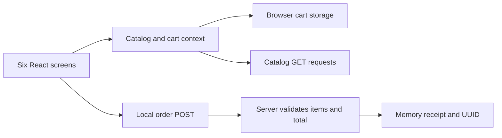

# 📚 Interview Practice - Readroom Bookstore


A small, responsive bookstore built with React and styled-components. Choose a bookshop, explore its books, inspect a product, edit a persistent cart, place a **local practice order**, and reopen the receipt by its UUID.

> Educational practice based on a bookstore exercise. All stores, books, customer examples and orders are synthetic. This is an explainable practice implementation; it does not claim an individual assessment was completed or passed.

## ▶️ How to run

Requires Node.js 20.19+ or 22.12+.

```bash
npm install
npm run dev
```

Open http://127.0.0.1:5325. Vite proxies /api to the fixture server on 127.0.0.1:5324. Both servers bind to the local computer. Use **fictional** names, address and phone details during checkout. No payment is collected.

```bash
npm test
npm run build
npm run preview
```

Preview needs the fixture API running separately with npm run api. The browser remembers cart contents in localStorage. Receipts exist in the fixture process memory and disappear when that process restarts.

## Six screens, one complete flow 🧭

| Screen          | Route after #                  | Behavior                                                              |
| --------------- | ------------------------------ | --------------------------------------------------------------------- |
| Bookshops       | /                              | Three synthetic shop profiles                                         |
| Shop collection | /stores/:storeId               | Books belonging to that shop                                          |
| Product         | /stores/:storeId/books/:bookId | Description, author, publisher, language and price                    |
| Cart            | /cart                          | Quantity changes, removal, integer-cent totals and empty state        |
| Checkout        | /checkout                      | Required fields, retry-safe local order and preserved cart on failure |
| Thank you       | /thanks/:orderId               | UUID receipt, reload, unavailable receipt and retry                   |

The interface supports English and Spanish. Hash routes work with static hosting. Layouts adapt to narrow screens; cart columns scroll inside the table container. Styled-components provides the visual system without Bootstrap or Material UI. Book covers are original typographic compositions; the shop image is an illustrative Unsplash library photograph, not evidence of a real shop.

## Architecture 🧩



- src/cart.js normalizes stored data and calculates totals in integer cents.
- src/context.jsx loads the catalog and handles cart state.
- src/api.js contains the HTTP boundary.
- server/orders.js recalculates prices from the server catalog, validates input and handles idempotent requests.
- An identical checkout retry returns the original order. Reusing its key with different details returns 409.
- Receipts retain a first name, total, timestamp and ID; the fixture does not store the address or phone.

## External catalog status 🌐

The exercise's Hasura books and stores GET endpoints were checked on 25 November 2026 and returned HTTP 500 with a project-unreachable page. No remote order was submitted.

VITE_CATALOG_BASE can select a read-only catalog base URL. The adapter expects stores and books envelopes and validates the local model (string IDs, integer priceCents and storeIds). **The live Hasura payload has not been verified or mapped**, so this option is an integration boundary, not a claim of a working live service. Checkout is disabled for external catalogs. Order mutations always target the local fixture.

To finish that integration after service recovery: inspect its public GET responses, map their actual fields, add contract tests, and test the order payload against a controlled fixture before any separately authorized remote transaction. No keys or customer records belong in the repository.

The separate full-name bookstore repository naming requirement and any personal assessment submission remain outside this monorepo practice folder.

## Verification and limits 🧪

Node tests exercise cart normalization, quantity and price validation, actual local HTTP CRUD boundaries, receipt UUIDs, repeat requests, conflicting keys, malformed JSON, missing records and payload limits. The production build is checked separately.

This intentionally small fixture has no authentication, database, inventory reservation or payment processing. It is local practice, not a production commerce service. Its English/Spanish catalog titles are original sample data. Technical-exam questions and protected source documents are not copied into this project.

Built with AI-assisted tooling; I reviewed, tested and can explain every change.
