# 🥷 Exercises XP Ninja

<div align="center">



</div>

The harder Day 1 set, in [exercisesxpninja.py](exercisesxpninja.py). Two exercises are about how the terminal finds Python, one is a list of boolean puzzles, one counts characters and the last is a little game: type sentences without the letter A.

## ▶️ How to run

```bash
python exercisesxpninja.py
```

For Exercise 5 I type sentences and press Enter on an empty line to stop:

```
Enter sentences without the letter A. Press Enter to finish.
Sentence: a dog
That sentence contains the letter A. Try again.
Sentence: hello world
Congratulations! New longest sentence: 11 characters.
Sentence: hi
Sentence:
Longest valid sentence: hello world
```

## 🎯 The challenge

1. **Terminal and PATH**: the system searches the folders listed in `PATH` for programs, which is why `python` works from any directory.
2. **The `py` command**: on Windows `py` is the Python Launcher. It is not a PowerShell alias.
3. **Boolean outputs**: I wrote my guess as a comment above each line before running it.
   - `3 <= 3 < 9` and `3 == 3 == 3` are both `True` (chained comparisons)
   - `bool(0)` and `bool(5 == "5")` are `False`
   - `bool(4 == 4) == bool("4" == "4")` is `True`, `bool(bool(None))` is `False`
   - `True + 4` gives `5` and `False + 10` gives `10`, because `bool` is a kind of `int`
4. **Character count**: `len(my_text)` on the Lorem ipsum paragraph prints 445. Spaces and punctuation count.
5. **Longest sentence without A**: `contains_letter_a()` uses `casefold()` so `A` and `a` are both caught. A new sentence only wins if it is strictly longer than the current one, so "hi" above gets no message.

## 🧪 Tests

From the repository root:

```bash
python -m unittest discover -s tests/python -p "test_week1_day1_exercises_xp_ninja.py" -v
```

7 tests in [test_week1_day1_exercises_xp_ninja.py](../../../../tests/python/test_week1_day1_exercises_xp_ninja.py) cover all five exercises.

## 🧠 What I learned

- Python lets me chain comparisons like `3 <= x < 9`, and both parts have to be true
- `0`, `None` and `""` all turn into `False` with `bool()`
- Guessing first and running second showed me where I was wrong, like `True + 4`
- My A check only knows plain `a`. An accented `á` slips through, so I'd have to normalize the text to catch it

---

## 👤 Author

**Kevin Cusnir 'Lirioth'**  
Repository: [Fullstack2026](https://github.com/LiriothTeltanion/Fullstack2026)  
Week 1 Day 1 - Starting with Python - Exercises XP Ninja
