# 🧪 Remote Exercise - Password Checker

<div align="center">




</div>

A small password gate in [password_checker.py](password_checker.py): it keeps asking until the password passes every rule, then gives it a strength label.

## ▶️ How to run

```bash
python password_checker.py
```

With three tries typed in a row (`hello`, `Hello123`, `Hello123!x`):

```
Choose a password: Not yet. It still needs:
  - at least 8 characters
  - one uppercase letter
  - one digit
  - one special character (!@#$%^&*?_-+=.)
Choose a password: Not yet. It still needs:
  - one special character (!@#$%^&*?_-+=.)
Choose a password: Password accepted. Strength: good
```

## 🎯 The challenge

| Function | What it does |
|---|---|
| `missing_rules(password)` | Returns the list of rules the password breaks: length 8+, an uppercase letter, a lowercase letter, a digit, a character from `SPECIAL_CHARACTERS`, and no spaces. An empty list means it passed. |
| `strength(password)` | `okay` under 10 characters, `good` from 10, `strong` from 14. |
| `main()` | A `while True` loop that prints what is missing and only `break`s when the list is empty. |

## 🧠 What I learned

- `any(char.isdigit() for char in password)` answers "is there at least one?" without a counter
- Returning the list of problems was more useful than `True`/`False`, because the user sees everything that is missing at once
- Keeping the rule numbers in constants (`MIN_LENGTH`, `SPECIAL_CHARACTERS`) means one edit changes both the check and the message
- The program prints the missing rules and the final verdict, never the password itself, so nothing secret ends up in a terminal log

---

## 👤 Author

**Kevin Cusnir 'Lirioth'**  
Repository: [Fullstack2026](https://github.com/LiriothTeltanion/Fullstack2026)  
Week 1 Day 1 - Starting with Python - Remote Exercise
