# 💪 Daily Challenges

The two Day 2 daily challenges: the regular one and the Gold one.

## Contents

- [`ListAndStrings/`](ListAndStrings/) — multiples of a number and collapsing repeated letters
- [`GoldHappyBirthday/`](GoldHappyBirthday/) — an ASCII cake with one candle per last digit of your age

---

## 👤 Author

**Kevin Cusnir 'Lirioth'**  
Repository: [Fullstack2026](https://github.com/LiriothTeltanion/Fullstack2026)  
Week 1 Day 2 - Lists, Iteration and Data Formatting - Daily Challenges
