# 🥉 Exercises XP

<div align="center">




</div>

Ten Day 2 exercises in [exercisesxp.py](exercisesxp.py), going from basic collections (sets, tuples, lists) to small interactive programs with loops.

## ▶️ How to run

```bash
python exercisesxp.py
```

Shortened sample (set order can vary):

```
our_fav_numbers: {1, 3, 7, 42, 27, 13}
tuple: (1, 2, 3, 4, 5)
apples count: 2
final basket: []
sequence: [1.5, 2, 2.5, 3, 3.5, 4, 4.5, 5]
...
Sorry, no Pastrami today.
I made your Tuna sandwich.
I made your Avocado sandwich.
I made your Egg sandwich.
I made your Chicken sandwich.
Finished sandwiches: ['Tuna', 'Avocado', 'Egg', 'Chicken']
```

## 🎯 The challenge

1. **Favorite numbers (sets)** - add numbers, remove one with `.discard()`, merge with a friend's set using `.union()`.
2. **Tuple** - `t = t + (4, 5)` creates a new tuple, because tuples can't change in place.
3. **Basket** - `remove()`, `append("Kiwi")`, `insert(0, "Apples")`, `count()`, then `clear()`.
4. **Floats** - builds `[1.5, 2, 2.5, 3, 3.5, 4, 4.5, 5]`, turning whole values like `2.0` into `2`.
5. **For loop** - prints 1 to 20, then only the items with an even index (which are the odd numbers).
6. **While loop** - keeps asking for a name until it matches "Kevin" (ignoring case and spaces).
7. **Favorite fruits** - splits a space-separated string into a list and checks if a fruit is in it.
8. **Pizza toppings** - adds toppings until `quit`; $10 base plus $2.50 per topping.
9. **Cinemax tickets** - collects ages until `done`; under 3 is free, 3-12 is $10, older is $15. A second loop keeps only the ages 16-21 for a restricted movie.
10. **Sandwich orders** - removes every "Pastrami" (sold out), then makes the rest in order.

Exercises 6 to 9 ask for input.

## 🧠 What I learned

- Sets drop duplicates automatically but have no order
- `.remove(x)` only deletes the first match and fails if `x` is missing
- `enumerate()` starts counting at 0, which is easy to forget

---

## 👤 Author

**Kevin Cusnir 'Lirioth'**  
Repository: [Fullstack2026](https://github.com/LiriothTeltanion/Fullstack2026)  
Week 1 Day 2 - Lists, Iteration and Data Formatting - Exercises XP
