# 🥇 Exercises XP Gold

<div align="center">




</div>

Nine more Day 2 exercises in [exercisesxpgold.py](exercisesxpgold.py). Most are list and loop practice; the last one is a small guessing game against `random`.

## ▶️ How to run

```bash
python exercisesxpgold.py
```

Shortened sample:

```
exercise1: [1, 2, 3, 4, 5, 6]
1505
1540
1575
...
The greatest number is: 42
a - vowel
b - consonant
...
min: 1, max: 1000000, sum: 500000500000
['12', '7', '33']
('12', '7', '33')
Guess 1-9 (or 'q' to quit): 5
better luck next time (number was 9 )
Guess 1-9 (or 'q' to quit): q
games won: 0 games lost: 1
```

## 🎯 The challenge

1. **Concatenate lists**: no `+` allowed, so I copy `a` with `list(a)` and call `.extend(b)` on the copy.
2. **Multiples of 5 and 7**: every number from 1500 to 2500 where `n % 5 == 0 and n % 7 == 0`.
3. **Check the index**: looks up a name in a list of game characters (Samus, Cortana, Link…) and prints its first index, or `name not found`.
4. **Greatest number**: three `int(input())` calls and `max(x, y, z)`.
5. **The alphabet**: each letter is checked against `"aeiou"`, so `y` ends up as a consonant.
6. **Words and letters**: 7 words and one character, then `.find()` tells me the first position in each word or says it isn't there.
7. **Min, max, sum**: for 1 to 1,000,000. I skipped building a million-item list and used `n * (n + 1) // 2`.
8. **List and tuple**: splits comma-separated input, strips spaces and prints it as a list and as a tuple.
9. **Guessing game**: a guess from 1 to 9 against `random.randint(1, 9)`, `q` to quit. Text prints `invalid` and 0 or 10 prints `out of range`; neither counts as a game.

Exercises 3, 4, 6, 8 and 9 ask for input. Exercise 4 has no validation, so typing a word there crashes with `ValueError`.

## 🧠 What I learned

- `extend()` changes the list it's called on, which is why I copy `a` first
- `if user in names` before `.index()` avoids the `ValueError` for a missing name
- `.find()` returns -1 instead of failing, so it fits a loop better than `.index()`
- The Gauss formula gives the same sum as `sum(range(...))` without the big list

---

## 👤 Author

**Kevin Cusnir 'Lirioth'**  
Repository: [Fullstack2026](https://github.com/LiriothTeltanion/Fullstack2026)  
Week 1 Day 2 - Lists, Iteration and Data Formatting - Exercises XP Gold
