# 🥷 Exercises XP Ninja

<div align="center">




</div>

The four Ninja exercises for Day 2 live in [exercisesxpninja.py](exercisesxpninja.py), standard library only. I wrote each one as a function that returns its result, and `_cli()` does the asking and printing.

## ▶️ How to run

```bash
python exercisesxpninja.py
```

It asks for input twice, at the start and at the end. Everything in between prints by itself:

```
Enter D values (comma-separated): 100,150,180
18,22,24
list: 3 47 99 -80 22 97 54 -23 5 7
desc: 99 97 54 47 22 7 5 3 -23 -80
sum: 231
...
Enter a line for word frequency: Python python is fun, fun python
Python:1
fun:1
fun,:1
is:1
python:2
```

## 🎯 The challenge

| Function | What it does |
|---|---|
| `q_values(d_values)` | `Q = sqrt((2 * C * D) / H)` with `C = 50` and `H = 30`, rounded, for each `D` I type. |
| `number_report(numbers)` | Takes `NUMS = [3, 47, 99, -80, 22, 97, 54, -23, 5, 7]` and returns a dictionary: the list, the list sorted high to low, sum, first and last, above 50, below 10, squares, no duplicates, average, max and min. It also does sum, average, max and min by hand in one loop. |
| `analyse_paragraph(text)` | Characters, sentences (counting `.`, `!` and `?`), words, unique words, non-space characters, words per sentence and how many words repeat. If there is no sentence ending it counts one sentence, so the division never fails. |
| `word_frequency(tokens)` | A `Counter` turned into a dictionary sorted by word. It splits on spaces and keeps case, so `Python` and `python` are separate, and so are `fun,` and `fun`. |

## 🧠 What I learned

- `** 0.5` is a square root, so I didn't even need `math.sqrt()`
- `Counter` counts words in one call, and `sorted(...items())` puts the output in a stable order
- Doing max and min by hand starts from `numbers[0]`, which would break on an empty list
- Returning a dictionary from `number_report()` let `_cli()` print the pieces in any order

---

## 👤 Author

**Kevin Cusnir 'Lirioth'**  
Repository: [Fullstack2026](https://github.com/LiriothTeltanion/Fullstack2026)  
Week 1 Day 2 - Lists, Iteration and Data Formatting - Exercises XP Ninja
