# 📚 Exercises

The Day 2 exercises in three levels, all plain Python scripts that run from the terminal.

## Contents

- [`ExercisesXP/`](ExercisesXP/) — 10 exercises on sets, tuples, list methods, loops and interactive pricing
- [`ExercisesXPGold/`](ExercisesXPGold/) — 9 exercises: list concatenation, ranges, `index()`, `max()` and a guessing game
- [`ExercisesXPNinja/`](ExercisesXPNinja/) — 4 exercises: a formula, list statistics, paragraph analysis and word frequency

---

## 👤 Author

**Kevin Cusnir 'Lirioth'**  
Repository: [Fullstack2026](https://github.com/LiriothTeltanion/Fullstack2026)  
Week 1 Day 2 - Lists, Iteration and Data Formatting - Exercises
