# 🧪 Remote Exercise - Tricky Counter

<div align="center">




</div>

The tricky part of this counter is direction: [tricky_counter.py](tricky_counter.py) counts from a start to an end number in either direction, always including the end, and then counts what came out.

## ▶️ How to run

```bash
python tricky_counter.py
```

```
Start, end and step (for example 10 -3 3): 10 -3 3
Counted: 10, 7, 4, 1, -2
That is 5 numbers.
    even: 3
     odd: 2
positive: 4
negative: 1
    zero: 0
Digits used: {'0': 1, '1': 2, '2': 1, '4': 1, '7': 1}
```

## 🎯 The challenge

| Function | What it does |
|---|---|
| `tricky_count(start, end, step)` | Builds the list with `range()`. The step is taken as positive and the sign comes from comparing `start` and `end`. A step of 0 raises `ValueError`. |
| `count_kinds(numbers)` | One loop that counts even, odd, positive, negative and zero values into a dictionary. |
| `count_digits(numbers)` | Turns each number into a string (without the minus sign) and counts every digit. |

`-3` is never reached with a step of 3 from 10, so the list stops at `-2`. That is the same rule `range()` follows.

## 🧠 What I learned

- `range()` leaves out its stop value, so I pass `end + 1` going up and `end - 1` going down
- `-2 % 2 == 0` is true in Python, so negative even numbers need no special case
- `counts.get(digit, 0) + 1` is a short way to count without checking if the key exists first
- Printing with `f"{kind:>8}"` lines the labels up on the right

---

## 👤 Author

**Kevin Cusnir 'Lirioth'**  
Repository: [Fullstack2026](https://github.com/LiriothTeltanion/Fullstack2026)  
Week 1 Day 2 - Lists, Iteration and Data Formatting - Remote Exercise
