# 📚 Day 2 — Lists, Iteration and Data Formatting

<div align="center">




</div>

Day 2 was about Python's collection types and loops: lists, tuples and sets, `for` and `while` loops, and formatting output with f-strings. Most exercises turn into small console tools, like a pizza order or a cinema ticket calculator.

## 📁 What's here

| Folder | What it covers |
|---|---|
| [Exercises XP](Exercises/ExercisesXP/) | 10 exercises on sets, tuples, list methods, loops and interactive pricing. |
| [Exercises XP Gold](Exercises/ExercisesXPGold/) | 9 exercises: list concatenation, ranges, `index()`, `max()`, a guessing game. |
| [Exercises XP Ninja](Exercises/ExercisesXPNinja/) | 4 exercises: a formula, list statistics, paragraph analysis, word frequency. |
| [Lists & Strings](DailyChallenge/ListAndStrings/) | Multiples of a number and collapsing repeated letters. |
| [Happy Birthday](DailyChallenge/GoldHappyBirthday/) | An ASCII cake with one candle per last digit of your age. |

## ▶️ Run

From the repository root:

```bash
python Week1Python/Day2ListsIteratingAndFormattingData/Exercises/ExercisesXP/exercisesxp.py
python Week1Python/Day2ListsIteratingAndFormattingData/Exercises/ExercisesXPGold/exercisesxpgold.py
python Week1Python/Day2ListsIteratingAndFormattingData/Exercises/ExercisesXPNinja/exercisesxpninja.py
python Week1Python/Day2ListsIteratingAndFormattingData/DailyChallenge/ListAndStrings/dailychallengelistandstrings.py
python Week1Python/Day2ListsIteratingAndFormattingData/DailyChallenge/GoldHappyBirthday/happybirthday.py
```

## 📊 List, set or tuple?

| | List `[]` | Set `{}` | Tuple `()` |
|---|---|---|---|
| Ordered | yes | no | yes |
| Can change | yes | yes | no |
| Duplicates | allowed | removed | allowed |
| Good for | a shopping basket | unique values, fast `in` checks | fixed values like coordinates |

## 💡 What I learned

- `enumerate()` gives me the index and the value in the same loop.
- `range(1, 11)` stops before 11, so the end value needs +1.
- Removing items from a list while looping over it skips elements; I loop over a copy or build a new list.
- `append()` adds one item (even a whole list), `extend()` adds each item.
- Sometimes math beats a loop: the Gold sum of 1 to 1,000,000 uses `n * (n + 1) // 2`.

## 👤 Author

**Kevin Cusnir 'Lirioth'**  
Repository: [Fullstack2026](https://github.com/LiriothTeltanion/Fullstack2026)
