# 🌟 Daily Challenge Gold - Caesar Cipher

<div align="center">




</div>

My Caesar cipher in [caesarcipher.py](caesarcipher.py). It can encrypt, decrypt, or try all 26 shifts when I don't know the key. Without arguments it opens a menu; with flags it runs once and exits.

## ▶️ How to run

The menu (`E`ncrypt, `D`ecrypt, `B`rute-force, `Q`uit):

```bash
python caesarcipher.py
```

With flags:

```bash
python caesarcipher.py --mode encrypt --shift 3 --text "Hello, World!"
python caesarcipher.py --mode decrypt --shift 3 --text "Khoor, Zruog!"
python caesarcipher.py --mode brute --text "Khoor, Zruog!"
```

The brute-force run prints one line per shift, and the right one is easy to spot:

```
shift= 0: Khoor, Zruog!
shift= 1: Jgnnq, Yqtnf!
shift= 2: Ifmmp, Xpsme!
shift= 3: Hello, World!
...
```

## 🎯 The challenge

| Function | What it does |
|---|---|
| `_shift_char(ch, shift)` | Moves an ASCII letter with `ord()`, `% 26` and `chr()`, keeping its case. Anything else stays. |
| `encrypt(text, shift)` | Runs `_shift_char()` over the text. Negative shifts work too. |
| `decrypt(text, shift)` | Just `encrypt(text, -shift)`. |
| `brute_force(text)` | A generator that yields `shift=N: ...` for shifts 0 to 25. |
| `interactive_main()` / `cli_main()` | The menu loop, and the `argparse` version with `--mode`, `--shift` (default 3) and `--text`. |

## 🧠 What I learned

- Subtracting `ord('A')` or `ord('a')` puts the letter on a 0-25 scale, and that is what makes `% 26` work
- Writing `decrypt` as a negative `encrypt` meant one place to fix bugs instead of two
- Checking `'A' <= ch <= 'Z'` keeps punctuation and accented letters out of the shift
- `argparse` with `choices=[...]` rejects a wrong mode before my code even runs

---

## 👤 Author

**Kevin Cusnir 'Lirioth'**  
Repository: [Fullstack2026](https://github.com/LiriothTeltanion/Fullstack2026)  
Week 1 Day 3 - Dictionaries - Daily Challenge Gold
