# 💪 Daily Challenge - Dictionaries

<div align="center">




</div>

Two problems in [dictionaries.py](dictionaries.py). First, a dictionary that says at which positions each letter of a word appears. Second, a shopping list: given prices as strings like `"$1,000"` and a wallet, which items can I buy?

## ▶️ How to run

```bash
python dictionaries.py
```

I type a word, it prints the letter map and then runs the three shopping examples from the exercise:

```
Enter a word: mississippi
{'m': [0], 'i': [1, 4, 7, 10], 's': [2, 3, 5, 6], 'p': [8, 9]}
['Bread', 'Fertilizer', 'Water']
['Apple', 'Bananas', 'Fan', 'Honey', 'Pan', 'Spoon']
Nothing
```

## 🎯 The challenge

| Function | What it does |
|---|---|
| `letter_indices(word)` | Walks the word with `enumerate()` and appends each index to that letter's list. |
| `to_int(value)` | Strips the `$` and the commas so `"$1,000"` becomes `1000`. |
| `affordable_items(items, wallet)` | Keeps the names whose price is at most the wallet and returns them sorted. `_cli()` prints `Nothing` when the list is empty. |

The heart of the first part is two lines:

```python
for idx, ch in enumerate(word):
    positions.setdefault(ch, []).append(idx)
```

| Wallet | Result |
|--------|--------|
| `$300` | `['Bread', 'Fertilizer', 'Water']` |
| `$100` | `['Apple', 'Bananas', 'Fan', 'Honey', 'Pan', 'Spoon']` |
| `$1` | `Nothing` |

The `$100` case includes the Pan at exactly `$100`, because I compare with `<=`.

## 🧠 What I learned

- `setdefault(ch, [])` creates the list the first time a letter shows up and returns the same list after that
- Prices stored as text need cleaning before any comparison, two `.replace()` calls were enough here
- `sorted()` accepts a generator directly, so I never built a temporary list
- Dictionaries keep insertion order, which is why the letter map follows the word

---

## 👤 Author

**Kevin Cusnir 'Lirioth'**  
Repository: [Fullstack2026](https://github.com/LiriothTeltanion/Fullstack2026)  
Week 1 Day 3 - Dictionaries - Daily Challenge
