# 💪 Daily Challenges

Day 3 came with a regular challenge and a Gold one.

## Contents

- [`Dictionaries/`](Dictionaries/): letter positions with `setdefault()` and a wallet that decides what I can afford
- [`CaesarCypher/`](CaesarCypher/): the Gold one, a Caesar cipher with a menu and command-line flags

---

## 👤 Author

**Kevin Cusnir 'Lirioth'**  
Repository: [Fullstack2026](https://github.com/LiriothTeltanion/Fullstack2026)  
Week 1 Day 3 - Dictionaries - Daily Challenges
