# 🥉 Exercises XP

<div align="center">




</div>

Four exercises on dictionary basics, all in [exercisesxp.py](exercisesxp.py): a dictionary made from two lists, a cinema bill for a family, a nested brand dictionary I had to edit step by step, and three mappings built from one list of Disney characters.

## ▶️ How to run

```bash
python exercisesxp.py
```

Everything prints in order. Halfway through it asks `Add extra family? (y/n)` for the ticket bonus, and `n` skips it:

```
{'Ten': 10, 'Twenty': 20, 'Thirty': 30}
rick pays 15
beth pays 15
morty pays 10
summer pays 10
total: 50
Add extra family? (y/n): n
Zara clients: men, women, children, home
last competitor: Desigual
US colors: ['pink', 'green']
...
{'Ariel': 0, 'Donald': 1, 'Mickey': 2, 'Minnie': 3, 'Pluto': 4}
```

## 🎯 The challenge

| Function | What it does |
|---|---|
| `build_dict(keys, values)` | `zip()` pairs `["Ten", "Twenty", "Thirty"]` with `[10, 20, 30]`. |
| `ticket_price(age)` | 0 under 3, 10 from 3 to 12, 15 from 13 up. |
| `cinemax_report(family)` | Goes through Rick, Beth, Morty and Summer with `.items()`, builds the "pays" lines and the total of 50. |
| `_bonus_prompt()` | Lets me add more people from the keyboard. A negative age or text is skipped with a warning and it asks again. |
| `update_brand(brand)` | Edits a copy of the Zara dictionary in the order the exercise asks: `number_stores = 2`, adds `country_creation`, appends "Desigual", pops `creation_date`, then `.update()` with `more_on_zara`. That last step puts `creation_date` back and sets the stores to 10000. |
| `brand_summary(brand)` | Picks out the clients, the last competitor, the US colours, the key count and the merged dictionary for printing. |
| `disney_mappings(users)` | Three dictionary comprehensions over `enumerate()`: name to index, index to name, and name to index after `sorted()`. |

## 🧠 What I learned

- `dict(zip(keys, values))` turns two matching lists into a dictionary without a loop
- `.update()` overwrites keys that already exist, which is why the store count jumps to 10000
- `.pop("creation_date", None)` doesn't crash if the key is already gone
- `dict(brand)` copies only the top level, so the competitors list inside is still shared with the original

---

## 👤 Author

**Kevin Cusnir 'Lirioth'**  
Repository: [Fullstack2026](https://github.com/LiriothTeltanion/Fullstack2026)  
Week 1 Day 3 - Dictionaries - Exercises XP
