# 🥇 Exercises XP Gold

<div align="center">




</div>

Two small console exercises in [exercisesxpgold.py](exercisesxpgold.py): a birthday lookup with an optional insert, and a fruit shop that adds up the cost of all its stock. The interactive part lives in `_cli()`, so importing the module only exposes the helpers.

## ▶️ How to run

```bash
python exercisesxpgold.py
```

```
Welcome! You can look up the birthdays of the people in the list.
Names: Alice, Bob, Charlie, Dana, Eli
Add a name (or press Enter to skip): Kevin
Enter birthday (YYYY/MM/DD): 1994/06/16
Names: Alice, Bob, Charlie, Dana, Eli, Kevin
Who do you want to look up? Kevin
Kevin's birthday is 1994/06/16
banana costs 4
apple costs 2
orange costs 1.5
pear costs 3
Total cost to buy everything: 89.0
```

## 🎯 The challenge

| Function | What it does |
|---|---|
| `add_birthday(birthdays, name, date)` | Returns a new dictionary with the extra person. |
| `lookup_birthday(birthdays, name)` | Returns the stored date, or `None` if the name is not there. |
| `stock_value(items)` | Multiplies `price * stock` for every fruit in the nested dictionary and sums it: 4 × 10 + 2 × 5 + 1.5 × 24 + 3 × 1 = 89.0. |

Exercises 1-3 are the birthdays (show the names, optionally add one, look one up) and Exercise 4 is the fruit shop. Dates are plain text, and names are case-sensitive (`"alice"` is not `"Alice"`).

## 🧠 What I learned

- `", ".join(birthdays.keys())` prints the names on one line
- Returning a new dictionary instead of changing the old one keeps the helpers easy to test
- A generator inside `sum()` adds up a nested dictionary in one line

---

## 👤 Author

**Kevin Cusnir 'Lirioth'**  
Repository: [Fullstack2026](https://github.com/LiriothTeltanion/Fullstack2026)  
Week 1 Day 3 - Dictionaries - Exercises XP Gold
