# 🥷 Exercises XP Ninja

<div align="center">




</div>

The car manufacturers exercise, in [xpninjacars.py](xpninjacars.py). It starts from the string `"Volkswagen, Toyota, Ford Motor, Honda, Chevrolet"` and answers a list of questions about it, one small function per question.

## ▶️ How to run

```bash
python xpninjacars.py
```

```
Total manufacturers: 5
Descending (Z-A): ['Volkswagen', 'Toyota', 'Honda', 'Ford Motor', 'Chevrolet']
Manufacturers with letter 'o': 5
Manufacturers without letter 'i': 5
No-duplicate list: Honda, Volkswagen, Toyota, Ford Motor, Chevrolet
New total (no duplicates): 5
Ascending A-Z with reversed names: ['telorvehC', 'rotoM droF', 'adnoH', 'atoyoT', 'negawskloV']
```

## 🎯 The challenge

| Function | What it does |
|---|---|
| `parse_manufacturers(names)` | Splits on commas, strips the spaces and drops empty pieces. |
| `sort_descending(names)` | Z to A, ignoring case. |
| `count_with_letter(names, letter)` | How many names contain the letter, upper or lower case. |
| `count_without_letter(names, letter)` | The opposite count. |
| `deduplicate_preserve_order(names)` | Bonus: removes repeats but keeps the order they first appeared in. |
| `ascending_reversed(names)` | Bonus: sorts A to Z, then writes each name backwards. |

For the duplicates bonus I used a second list with Honda and Toyota twice. Seven names go in and five come out.

## 🧠 What I learned

- `sorted(..., key=lambda value: value.lower(), reverse=True)` sorts Z to A and leaves the original list alone
- A `set` makes "have I seen this?" fast, and the separate list keeps the order a set would lose
- `name[::-1]` flips a string with slicing
- Lowering both sides (`letter.lower()` and `name.lower()`) makes the letter counts case-insensitive

---

## 👤 Author

**Kevin Cusnir 'Lirioth'**  
Repository: [Fullstack2026](https://github.com/LiriothTeltanion/Fullstack2026)  
Week 1 Day 3 - Dictionaries - Exercises XP Ninja
