# ➕ Exercises XP Plus

<div align="center">




</div>

Two extra Day 3 exercises in [exercisesxpplus.py](exercisesxpplus.py): grade summaries with letter grades, and some basic analysis over a list of sales transactions. Everything uses plain dictionaries and lists, no external packages.

## ▶️ How to run

```bash
python exercisesxpplus.py
```

Shortened output:

```
class average: 84.87
Alice - 93.33 A
Bob - 77.67 C
...
product totals: {'Smartphone': 2150.0, 'Laptop': 2200.0, 'Headphones': 800.0}
customer totals: {1: 1800.0, 2: 2200.0, 3: 1150.0}
...
loyal customers: [1, 2, 3]
most popular: ['Headphones']
```

## 🎯 The challenge

| Function | What it does |
|---|---|
| `letter_grade(score)` | Walks through `GRADE_THRESHOLDS`: `>= 90` → A, `>= 80` → B, `>= 70` → C, `>= 60` → D, otherwise F. |
| `calculate_student_grades(grades)` | Returns each student's average and letter, plus the class average. A student with no scores gets `0.0` and `"N/A"`, so there is no division by zero. |
| `analyse_sales_data(transactions)` | Adds `total_price = price * quantity`, sums totals per product and per customer, keeps transactions above 500 sorted from highest to lowest, finds loyal customers (more than one purchase), averages each product's transactions and finds the most popular product by quantity. It returns a list for the most popular product, so ties are kept. |

The `.get(key, 0)` pattern is what I used for every counter:

```python
product_totals[record["product"]] = product_totals.get(record["product"], 0.0) + total_price
```

## 🧠 What I learned

- Building summaries with dictionaries and `.get()` defaults
- Sorting a list of dicts with `key=lambda ...` and `reverse=True`
- Returning a list when there can be a tie instead of picking one value

---

## 👤 Author

**Kevin Cusnir 'Lirioth'**  
Repository: [Fullstack2026](https://github.com/LiriothTeltanion/Fullstack2026)  
Week 1 Day 3 - Dictionaries - Exercises XP Plus
