# 📚 Exercises

The Day 3 dictionary exercises: four XP levels and two timed challenges.

## Contents

- [`ExercisesXP/`](ExercisesXP/) — `zip()`, Cinemax ticket prices, the nested Zara brand dict, Disney character mappings
- [`ExercisesXPPlus/`](ExercisesXPPlus/) — student grade summary and sales data analysis
- [`ExercisesXPGold/`](ExercisesXPGold/) — birthday lookup and a fruit shop stock calculator
- [`ExercisesXPNinja/`](ExercisesXPNinja/) — car manufacturer list: counting, sorting, removing duplicates
- [`TimedChallenge1/`](TimedChallenge1/) — reversing the words of a sentence
- [`TimedChallenge2/`](TimedChallenge2/) — checking for a perfect number

---

## 👤 Author

**Kevin Cusnir 'Lirioth'**  
Repository: [Fullstack2026](https://github.com/LiriothTeltanion/Fullstack2026)  
Week 1 Day 3 - Dictionaries - Exercises
