# 🧪 Remote Exercise - List Comprehension

<div align="center">




</div>

Six one-line answers in [list_comprehension.py](list_comprehension.py). Each task is a small function that returns a list, a dictionary or a set built with a comprehension.

## ▶️ How to run

```bash
python list_comprehension.py
```

```
1. Squares of evens: [64, 144, 400, 196]
2. Long words: ['PYTHON', 'COFFEE', 'DICTIONARY', 'LOOP']
3. Flat matrix: [1, 2, 3, 4, 5, 6, 7, 8, 9]
4. Word lengths: {'sky': 3, 'python': 6, 'map': 3, 'coffee': 6, 'dictionary': 10, 'is': 2, 'loop': 4}
5. Cheap items: {'tea': 9, 'water': 5}
6. First letters: ['c', 'd', 'i', 'l', 'm', 'p', 's']
Loop gives the same list: True
```

## 🎯 The challenge

| Function | Comprehension |
|---|---|
| `squares_of_evens(numbers)` | `[n * n for n in numbers if n % 2 == 0]` |
| `long_words_upper(words)` | Keeps words with 4+ letters and uppercases them |
| `flatten(matrix)` | Two `for` clauses: `[value for row in matrix for value in row]` |
| `word_lengths(words)` | A dict comprehension, word to length |
| `cheap_items(prices)` | Filters `PRICES.items()` to the items under 10 |
| `unique_first_letters(words)` | A set comprehension, then `sorted()` |

At the end `main()` solves task 1 again with a normal loop and checks that both give the same list.

## 🧠 What I learned

- In a nested comprehension the `for` clauses go in the same order as nested loops would
- Swapping `[]` for `{}` with `key: value` turns the same idea into a dictionary
- A set comprehension drops repeats by itself, which is why `s` from `sky` appears once
- Writing task 1 as a loop too made it clear the comprehension is just a shorter loop

---

## 👤 Author

**Kevin Cusnir 'Lirioth'**  
Repository: [Fullstack2026](https://github.com/LiriothTeltanion/Fullstack2026)  
Week 1 Day 3 - Dictionaries - Remote Exercise
